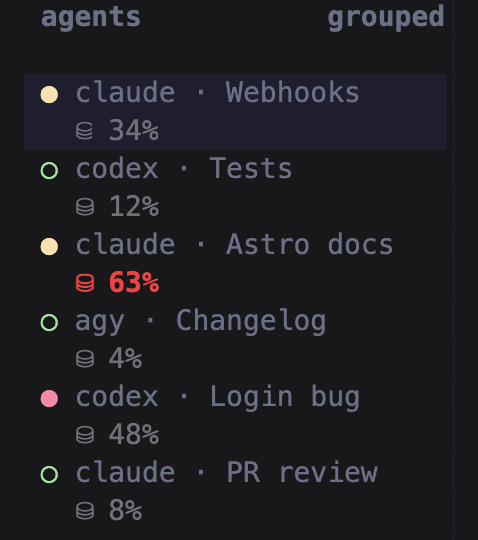
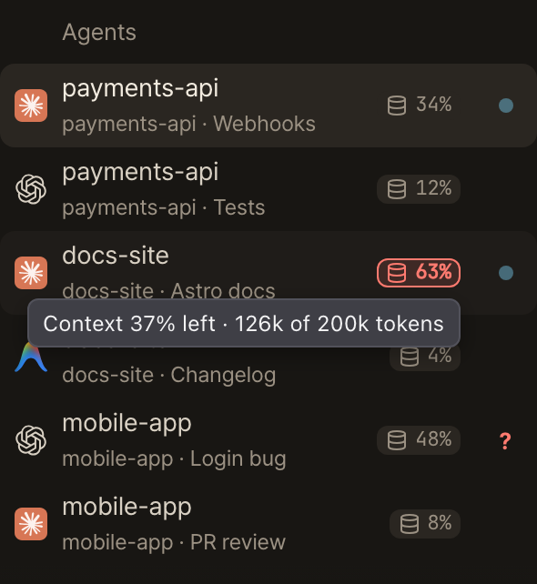

# herdr-context-monitor

[](https://github.com/EMRahman/herdr-context-monitor/actions/workflows/ci.yml)
[](LICENSE)

**A minimal context meter for [Herdr](https://herdr.dev): one Python file, no
build step, no dependencies.** It shows how full each agent's context window
is, right under that agent in the sidebar, and turns red above 50%. It supports
Claude Code, OpenAI Codex and Antigravity CLI.

| In the terminal (Herdr TUI) | In the browser ([herdr-web-ui](#web-ui-integration-companion-dependency)) |
| --- | --- |
|  |  |

## Minimal by design

It does one thing: context use per agent. It has no rate limits, cost
tracking, dashboards, popups or notifications, and adds nothing to your screen
beyond the reading itself.

- **In the terminal, one row.** A `⛁ 34%` line under each agent in Herdr's own
  sidebar, through Herdr's built-in sidebar rows. No pane, bar or popup of its
  own.
- **In the browser, one badge.** [herdr-web-ui](#web-ui-integration-companion-dependency)
  shows the same reading as a small badge next to each agent. Hover it to see
  what's left and the tokens behind it.
- **One file, nothing to build.** `monitor.py` is under 400 lines, uses only
  Python's standard library, and runs on the `python3` that macOS ships (3.9
  or later).
- **Cheap to run.** Every 5 seconds it reads only what each transcript gained
  since the last check, and updates Herdr only when a reading changes.
- **A right reading or none.** Each window comes from the agent itself or your
  config, and a pane it can't match shows nothing rather than a wrong number.

## How it works

- **Continuous Context Tracking**: Every 5 seconds, reads what each agent's session transcript gained and computes usage against its context window (see [Context window sizes](#context-window-sizes)).
  - **Antigravity CLI**: 1M token window
  - **Claude Code**: the window from the session's latest `/context` output, else a [configured](#context-window-sizes) window for the model, else 1M once usage passes 200k, else 200k
  - **OpenAI Codex**: the window Codex records in the transcript (`model_context_window`)
- **Readings only for the right session**: each pane is matched by its Herdr session id. Without one, a reading is guessed only for the single pane of that agent in a folder. When no reading can be made, the pane shows nothing rather than `0%`.
- **Herdr Integration**: Emits integer metrics (`ctx_pct=<N>`), the token counts behind them (`ctx_used=<tokens>`, `ctx_window=<tokens>`), a percentage unit (`ctx_unit=%`), and sidebar labels (`ctx_label=⛁ <N>%`) via `herdr pane report-metadata`.
- **TUI Highlighting**: Supports conditional rules in `~/.config/herdr/config.toml` (e.g. bold red alert when context > 50%; see [why 50%](#why-highlight-usage-above-50)).

## Installation

```bash
herdr plugin install EMRahman/herdr-context-monitor
```

Or link locally during development:

```bash
herdr plugin link /path/to/herdr-context-monitor
```

To update an installed GitHub plugin to the latest default-branch revision:

```bash
herdr plugin install EMRahman/herdr-context-monitor --yes
```

Changes in an open pull request are available only on its branch until merged.
To try one before merging, add `--ref <branch-name>` to the install command.
Updating the plugin does not modify your sidebar configuration; merge the
configuration below separately.

## Setup with a coding agent

Ask an agent running on the Herdr host to "set up herdr-context-monitor
following its README". Agents should follow these steps in order:

1. Install or upgrade the plugin:
   `herdr plugin install EMRahman/herdr-context-monitor --yes`
2. Back up `~/.config/herdr/config.toml`, then merge the row from
   [TUI Configuration](#tui-configuration) into it. Edit the existing
   `[ui.sidebar.agents]` section if there is one. Keep the user's other rows,
   replace any `$ctx_pct`, `$ctx_unit`, `$ctx_icon` or `$ctx_display*`
   entries with the new row, and do not add a second `[ui.sidebar.agents]`
   section. Validate with `herdr config check`.
3. Apply the configuration with `herdr server reload-config`.
4. Publish a reading with
   `herdr plugin action invoke refresh --plugin context-monitor`, then confirm
   `herdr api snapshot` contains `ctx_label` or `ctx_label_high`.
5. Ask the user to restart the Herdr server (`herdr server stop`, then run
   `herdr`) so continuous monitoring uses the installed code. Do not do this
   yourself: stopping the server ends every pane, including your own session.

Steps 2 and 3 apply to the machine that displays Herdr. If the user attaches
with `herdr --remote`, repeat them on the client machine too (see
[Remote terminal access](#remote-terminal-access)).

## TUI Configuration

Add to `~/.config/herdr/config.toml`:

```toml
[ui.sidebar.agents]
rows = [
  ["state_icon", "agent", "tab"],
  [
    { token = "$ctx_label", fg = "#71717a" },
    { token = "$ctx_label_high", fg = "#ef4444", bold = true }
  ]
]
```


The second row shows an icon and a single percentage, such as `⛁ 3%`. Herdr
puts a `·` between tokens in a row, so the monitor reports the icon and
percentage as one value. It reports `ctx_label` at 50% or below and
`ctx_label_high` above 50%, clearing the inactive token so only one is visible.
This preserves red, bold styling for high usage. To show the percentage without
the icon, use `$ctx_display` and `$ctx_display_high` instead; they follow the
same rule. The numeric `ctx_pct` and legacy `ctx_unit` tokens remain available
for existing consumers. Merge these rows into an existing `[ui.sidebar.agents]`
section rather than adding a duplicate section. After updating the plugin and
the configuration, use Herdr's **reload config** menu action to refresh the
sidebar.

After installing or upgrading the plugin in an already running server, restart
the Herdr server to start continuous monitoring with the installed code. An
existing monitor keeps running the code it loaded before the upgrade, so it
will not continuously publish the new display tokens. Reloading the sidebar
configuration alone does not restart the monitor. The monitor exits when the
server that started it stops, so a restart does not leave an old copy running.

To publish a single reading immediately, invoke the refresh action:

```bash
herdr plugin action invoke refresh --plugin context-monitor
```

This action runs once and does not start or restart continuous monitoring. It
does not replace the server restart after installation or upgrade. The
manifest's startup hook starts continuous monitoring when the Herdr server
starts; attaching a client, reloading configuration, and enabling a plugin do
not run startup hooks. Herdr does not supervise startup hooks as daemons.

## Context window sizes

Usage is a share of the model's context window. Codex records its window in
the transcript; Claude Code does not, so for Claude the monitor uses, in order:

1. the window from the session's most recent `/context` output, such as
   `107.9k/1m tokens (11%)`
2. a window configured for the model (below)
3. 1M, once a request has gone past 200k tokens
4. 200k

If your Claude model runs with a 1M window, set it so readings are not five
times too high before you run `/context`. Create `config.json` in the
directory printed by `herdr plugin config-dir context-monitor`:

```json
{
  "context_windows": {
    "claude-opus-5-5": 1000000
  }
}
```

Keys are model id prefixes, and the longest matching prefix wins. The same
setting supplies a Codex model's window when its transcript does not state
one; without either, that Codex pane shows no reading. The file is read on
every poll, so no restart is needed.

## Why highlight usage above 50%?

Models get less reliable as their context fills, well before they reach the
advertised limit. The 50% threshold is a practical rule of thumb for when to
compact, summarise or start a fresh session, not a figure taken from any one
study. The research behind it:

- [Lost in the Middle: How Language Models Use Long Contexts](https://arxiv.org/abs/2307.03172)
  (Liu et al., TACL 2024). Models use information at the start and end of
  their input best, and much worse when it sits in the middle. The effect
  grows with input length, even for long-context models.
- [RULER: What's the Real Context Size of Your Long-Context Language Models?](https://arxiv.org/abs/2404.06654)
  (Hsieh et al., NVIDIA, COLM 2024). Of 17 models that all claim at least 32K
  tokens of context, only half perform satisfactorily at 32K.
- [NoLiMa: Long-Context Evaluation Beyond Literal Matching](https://arxiv.org/abs/2502.05167)
  (Modarressi et al., ICML 2025). When the answer doesn't share wording with
  the question, 11 of 13 models fall below half their short-context score by
  32K tokens. GPT-4o drops from 99.3% to 69.7%.
- [Context Rot: How Increasing Input Tokens Impacts LLM Performance](https://www.trychroma.com/research/context-rot)
  (Chroma, July 2025). All 18 models tested, including Claude 4, GPT-4.1 and
  Gemini 2.5, become less reliable as input grows, even on simple tasks.
- [Effective context engineering for AI agents](https://www.anthropic.com/engineering/effective-context-engineering-for-ai-agents)
  (Anthropic, September 2025). Describes context as a finite "attention
  budget" and recommends compaction, note-taking and sub-agents for long
  tasks.

## Remote terminal access

Install the context monitor on the machine running the agents: it reads their
local transcript files and publishes context metadata to that machine's Herdr
server.

- **SSH into the Mac Mini, then run Herdr there:** the monitor and sidebar
  configuration on the Mini are used. No monitor installation on the MacBook
  is needed.
- **Run `herdr --remote <mini-ssh-target>` on the MacBook:** the monitor stays
  on the Mini, but the sidebar layout comes from the MacBook's local
  `~/.config/herdr/config.toml`. Add the rows above there too. No second monitor
  installation is needed unless agents also run locally on the MacBook.

See Herdr's [configuration documentation](https://herdr.dev/docs/configuration/)
for client-local presentation settings during remote attach.

## Web UI Integration (Companion Dependency)

The monitor emits token metadata to `pane.tokens.ctx_pct` via `herdr pane report-metadata`.

* **Stock herdr-web-ui**: Does not show this plugin's readings.
* **[EMRahman/herdr-web-ui](https://github.com/EMRahman/herdr-web-ui)**: Adds first-class visual badge support in the sidebar agent roster and composer ring (merged via [PR #2](https://github.com/EMRahman/herdr-web-ui/pull/2)), alerting in bold red when context usage exceeds 50%. Hovering a badge shows what's left and the tokens behind it, such as `Context 37% left · 126k of 200k tokens` ([PR #8](https://github.com/EMRahman/herdr-web-ui/pull/8)).

### Architecture & Relationship

```
┌─────────────────────────────────┐
│     herdr-context-monitor       │  (Data Provider)
│   • Runs `monitor.py` daemon    │
│   • Emits `pane.tokens.ctx_pct` │
└────────────────┬────────────────┘
                 │
                 ▼
┌─────────────────────────────────┐
│     Herdr Pane Metadata Bus     │
└───────────┬──────────────┬──────┘
            │              │
            ▼              ▼
┌────────────────┐  ┌──────────────────────────────────┐
│   Herdr TUI    │  │       EMRahman/herdr-web-ui      │  (Visual Consumer)
│  (config.toml) │  │   • Renders ContextBadge in      │
│  Works natively│  │     AgentSidebar.tsx             │
└────────────────┘  │   • Highlights > 50% context rot │
                    └──────────────────────────────────┘
```

To enable the Web UI badges alongside this plugin:
```bash
herdr plugin install github:EMRahman/herdr-web-ui
```

## Tests

The tests use only the Python standard library and run on Python 3.9 and later:

```bash
python3 -m unittest discover -s tests
```

CI runs them on Linux and macOS for every pull request.

## License

[MIT](LICENSE)
