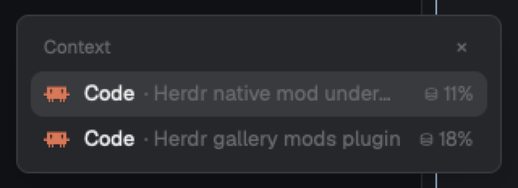

# herdr-context-monitor

[](https://github.com/EMRahman/herdr-context-monitor/actions/workflows/ci.yml)
[](LICENSE)

See how full each Claude Code, Codex and Antigravity agent’s context window is in the
[Herdr desktop app](https://herdr.dev). Context Monitor adds a panel under the
Agents list or opens as a floating window. Its header shows three database
pills with session counts for under 25%, 25% through 50%, and over 50% used.
Click a pill to list those sessions, fullest first. Hover a row for token
counts or click it to jump to that agent.



## Install

The mod requires Python 3.9 or later and uses the standard library. On macOS,
you can install Python with Xcode’s Command Line Tools (`xcode-select --install`).

**Ask your agent.** Paste this to an agent in the Herdr app. It follows
[`herdr-app/RECIPE.md`](herdr-app/RECIPE.md) and adds the panel to the layout
you use.

```text
Read ~/.config/herdr-app/AGENTS.md, then add this mod under my Agents list: github.com/EMRahman/herdr-context-monitor/tree/main/herdr-app
```

**Dock it with the helper.** Run this command from a clone of this repository
to install or update the mod.

```bash
python3 herdr-app/dock.py
```

The helper checks the mod and docks the panel under Agents.
If Herdr is running, the helper immediately switches to the layout it docks into,
which is `main-context` by default on a fresh install from a built-in layout.

- **In your own layout, if one is on screen**, it inserts the Context block
  after the Agents list. Re-running the helper also shrinks a Context block
  that still uses the previous default height.
- **In `main-context`, if a built-in layout is on screen**, it clones Herdr's
  `main` layout and adds a Context section under Agents. `ctrl-shift-l` switches
  back to `main`.

It remembers where it docked and uses that next time. `--layout <name>` docks in
another layout, and `--layout main-context` goes back to the built one. Moving
the panel removes it from its previous layout.

Herdr never updates a layout of your own. For `main-context`, when a Herdr update
changes `main`, the panel shows a toast, "Re-run dock.py to update main-context".
Running `python3 herdr-app/dock.py` again rebuilds `main-context` from the new
`main` and keeps any theme or font you set on it. If you edited `main-context` by
hand, it isn't replaced; `--force` rebuilds it and keeps a copy of yours. Other
mods can share `main-context`, such as
[herdr-usage-monitor](https://github.com/EMRahman/herdr-usage-monitor)'s
readout: their blocks don't count as edits and stay where they are through a
rebuild. `--status` shows where things stand, and `--undock` takes the panel out
(an unshared `main-context` is removed and you're back on `main`).

**Float it.** With no layout changes, copy the mod and open it as a window:

```bash
cp -R herdr-app/mods/context-monitor ~/.config/herdr-app/mods/
herdr-app do mod.open --name context-monitor
```

The window comes back after a restart until you close it with its `×`. Run the
same `mod.open` command to open or close it again.

## Moving from the TUI plugin

The TUI plugin is retired. Install the desktop mod using one of the options
above. If you set custom context windows for the TUI plugin, run
`herdr plugin config-dir context-monitor` to find its `config.json`. Copy its
`context_windows` entries into the desktop mod’s `config.json` and keep any
existing desktop overrides. [Context window sizes](#context-window-sizes)

To clean up the old installation, run `herdr plugin uninstall context-monitor`
and remove the context monitor’s `$ctx_*` entries from `[ui.sidebar.agents]` in
`~/.config/herdr/config.toml`. [Herdr plugin documentation](https://herdr.dev/tui/docs/plugins/#install-and-link)

## Context window sizes

The panel updates usage percentages every five seconds while a local agent is
present. It checks all three local model catalogs on the first poll and then
hourly, reusing cached sizes between checks. Catalog lookups use the exact
model ID.

| Agent | Window sources, in priority order |
| --- | --- |
| Claude Code | The session's `/context` output, a configured override, then the CLI model catalog's `runtime.max_input_tokens`. For Sonnet and Opus 4.6, 1M is opt-in. Without a usable size the monitor assumes 200k, or 1M after a request exceeds 200k. |
| Codex | The session's `model_context_window`, a configured override, then the effective window from `~/.codex/models_cache.json` (the default window times its effective percentage). A session needs one of these to appear. |
| Antigravity | A configured override, then the local gateway or CLI custom model list's `maxTokens`. When no local entry supplies a size, Gemini uses the 1M fallback and other models use 200k, or 1M after a request exceeds 200k. |

Claude Code's CLI catalogs are in `~/.claude/cache/model-catalog/*-cc.json`.
A catalog supplies a model default. For sessions that run with a different cap,
a configured override applies from the first reading and a later `/context`
result takes precedence.

This example sets a 1M window for Claude Opus 5.5 in
`~/.config/herdr-app/mods/context-monitor/config.json`.

```json
{
  "context_windows": {
    "claude-opus-5-5": 1000000
  }
}
```

Override keys are model ID prefixes, and the longest matching prefix wins. For
example, `claude-opus-5-5` also matches Antigravity's `claude-opus-5-5-high`.
Changes take effect on the next poll.

## How it works

Every five seconds the mod reads new entries from local Claude Code, Codex and
Antigravity transcripts. It uses the agent’s session ID when available (for
Antigravity, the conversation whose database the process has open). Otherwise it
searches by working directory when that folder has a single terminal for the
agent (for Antigravity, the conversation last run there). A
Codex title match must also match the terminal’s working directory. Remote agents
and sessions without a usable reading are omitted.

## Why highlight usage above 50%?

Models get less reliable as their context fills, well before they reach the
advertised limit. The 50% threshold is a practical rule of thumb for when to
compact, summarise or start a fresh session, not a figure taken from any one
study. The research behind it:

- [Lost in the Middle: How Language Models Use Long Contexts](https://arxiv.org/abs/2307.03172)
  (Liu et al., TACL 2024). Models use information at the start and end of
  their input best, and much worse when it sits in the middle. The effect
  grows with input length, even for long-context models.
- [RULER: What's the Real Context Size of Your Long-Context Language Models?](https://arxiv.org/abs/2404.06654)
  (Hsieh et al., NVIDIA, COLM 2024). Of 17 models that all claim at least 32K
  tokens of context, only half perform satisfactorily at 32K.
- [NoLiMa: Long-Context Evaluation Beyond Literal Matching](https://arxiv.org/abs/2502.05167)
  (Modarressi et al., ICML 2025). When the answer doesn't share wording with
  the question, 11 of 13 models fall below half their short-context score by
  32K tokens. GPT-4o drops from 99.3% to 69.7%.
- [Context Rot: How Increasing Input Tokens Impacts LLM Performance](https://www.trychroma.com/research/context-rot)
  (Chroma, July 2025). All 18 models tested, including Claude 4, GPT-4.1 and
  Gemini 2.5, become less reliable as input grows, even on simple tasks.
- [Effective context engineering for AI agents](https://www.anthropic.com/engineering/effective-context-engineering-for-ai-agents)
  (Anthropic, September 2025). Describes context as a finite "attention
  budget" and recommends compaction, note-taking and sub-agents for long
  tasks.

## Tests

The tests use only the Python standard library and run on Python 3.9 and later:

```bash
python3 -m unittest discover -s tests
```

CI runs them on Linux and macOS for every pull request.

## License

[MIT](LICENSE)
