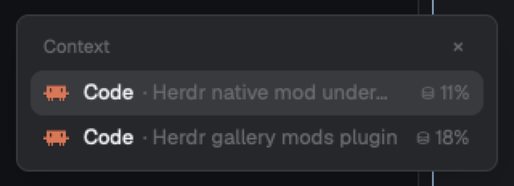

# Context Monitor

A Context panel that shows how full each agent's context window is: one
line per Claude Code or Codex agent on this computer, its space, its title and
`⛁ 34%`, in bold red above 50%. Hovering a line shows what's left and the tokens
behind it; clicking it goes to that agent. It is the Herdr app version of the
[herdr-context-monitor](https://github.com/EMRahman/herdr-context-monitor) TUI
plugin and uses the same `monitor.py`. It is only the panel: dock it under the
Agents list in your own layout (see **Built from**), or open it as a floating
window.

## What you see

- **A window**, 300px wide and as tall as its lines, in Herdr's own window frame
  (theme background, border, rounded corners, shadow). It opens where it was
  last dropped and comes back on the next start until closed.
- **Header**, 34px, 16px side padding, 8px top: `Context` at 11.5px medium in
  `dim`; on the right a `×` in `dim` (`hover` behind it, `foreground` text on
  hover) that closes the window.
- **One line per agent with a reading**, fullest first (highest percentage at
  the top; equal ones in `agents()` order: space, tab, pane), 28px tall, radius 8, inside 8px side padding, 9px gaps, 13px text:
  - the agent's program icon, 16px (tinted with `foreground` when the program
    table says `tint`);
  - its space name in `foreground` (at most 110px, cut with `…`), then
    `· <title>` in `dim`, filling the rest and cut with `…`. The title drops a
    leading status glyph or spinner and Codex's `[ ! ] ` / `[ . ] ` mark;
  - on the right, `⛁ 34%` at 12px in `dim`; above 50%, in `ansi1` and bold.
- **No readings yet**: one line at 12px in `dim`, "Claude Code and Codex agents
  on this computer show here after their first answer." If `python3` can't run or
  `monitor.py` fails, its last error line in `ansi1` takes its place.
- An agent with no reading has no line: never a guessed or `0%` value.

## How it behaves

- Every 5 seconds, while at least one agent is on this computer, it runs
  `python3 mods/context-monitor/monitor.py --app --config-dir mods/context-monitor`
  and redraws only when a reading or the error changes.
- Agent status (working, blocked, done, idle) doesn't change a line's look; the
  focused agent's line has `selected` behind it, and `hover` under the pointer.
- **Hover** a line: a tooltip `Context 66% left · 68k of 200k tokens` (counts as
  `k`, or `M` from a million).
- **Click** a line: `pane.focus {pane}` for that agent.
- **Drag** the window anywhere by a press that isn't on `×`.
- Lines appear and go as agents start, end or first answer.
- **Docked under Agents** (a layout block instead of a window): it fills the
  block with `chrome` behind it and a top `border`, like the Agents list above
  it; its header is 41px (14px top), with no `×`, and its lines scroll. In the
  sidebar's rail (narrower than 160px) it shows only each line's percentage,
  centered, without the header.
- **When Herdr updates its `main` layout** and the panel was docked by the
  repository's `herdr-app/dock.py` (below), the docked copy notices at start and
  posts one info toast per new `main`: "Herdr updated its main layout",
  "Re-run dock.py to update main-context". It only reads; it never changes a
  layout.

## Built from

- `mods/context-monitor/mod.json`: `"place": "none"` and `"overlay": { "kind":
  "window", "key": "context-monitor", "keep": true, "width": 300 }`, so
  `herdr-app do mod.open --name context-monitor` opens (and again, closes) it as a
  kept window.
- **Docked under Agents**: Herdr's shipped layouts are read-only, so the block
  goes in the person's own layout (for a shipped one, a clone first:
  `herdr-app do layout.clone '{"name":"main","as":"main-context"}'`), right after
  the block whose `content.mod` is `agents`, in the same column:
  `{ "id": "context", "type": "block", "size": { "px": 132 }, "min": 41, "content": { "mod": "context-monitor" } }`.
- `main.js`: one `View`. `init` starts `cx.timer.every(5000)` (not during
  `checking()`); the poll runs `exec("python3", …, { timeout: 20000 })` in
  `cx.spawn` and keeps `{ address: { pct, used, window } }`. `render` reads
  `agents()`, `theme()` and `props().overlay` (window or block), and uses
  `run("pane.focus")`, `closeOverlay`, `.tooltip`, `.on_size_change`. A docked
  copy reads `mods/context-monitor/.dock.json` (written by `dock.py`, if used)
  and `layouts/main.json` with `readTextFile`; when the shown layout
  (`shared("layout")`) is the one `dock.py` built and `main.json` differs from
  the `main_text` it recorded, it calls `notify`, remembering the new `main`'s
  fingerprint in `localStorage`.
- `monitor.py`: the TUI plugin's script, unchanged; `--app` prints one reading
  as JSON and exits. It reads terminals from herdr-core (`hc ls --json`, then
  `hc get <t> --json` for each `claude-code` or `codex` terminal: its foreground
  process's pid and folder, and its title), then finds each session:
  - Claude Code: `~/.claude/sessions/<pid>.json` names the session; its
    transcript is `~/.claude/projects/*/<session>.jsonl`.
  - Codex: the one rollout the process has open (`lsof -p <pid>`); with Codex's
    shared daemon holding several, the plugin's title-and-folder matching against
    `~/.codex/session_index.jsonl` and each rollout's first line.
  - Usage and window: as the plugin computes them (Claude's `/context` output,
    then `config.json` `context_windows`, then 1M past 200k, else 200k; Codex's
    `model_context_window`).
  - How far each transcript was read is kept in
    `~/.cache/herdr-context-monitor/app-state.json`, so each run reads only what
    was appended.
- Not part of the mod: the repository's `herdr-app/dock.py` (standard library)
  does the docking in one step for those who want it. It copies `main.js`,
  `mod.json` and `monitor.py` into `~/.config/herdr-app/mods/context-monitor/`
  and runs `herdr-app check`. Its layout: `--layout <name>`, else the one it
  used last time, else the layout on screen (`herdr-app status`) if that is a
  personal one (not an `installed.json` `layout:<name>` key) with the Agents
  list in a column, else `main-context`. In a personal layout it only adds the
  block above if missing, never rebuilding or fingerprinting it, and records
  `{layout, mode: "joined"}`. Moving to another layout takes the block out of
  the old one (and removes an untouched `main-context` nothing else shares).
  Otherwise it writes `layouts/main-context.json`: Herdr's current
  `layouts/main.json` with the block above and `cloned_from: {name: "main",
  version}`. It records what it wrote, the `main.json` it used and its own path
  in `mods/context-monitor/.dock.json` (hidden, so it doesn't reload the mod).
  Re-run, it rebuilds from the latest `main`, keeping root look keys (theme,
  fonts) changed in `main-context`, and refuses to replace a layout whose tree
  differs from what it wrote unless `--force`, which keeps
  `main-context.json.old-<time>`.
  Other mods can share `main-context`: a block showing a mod that is neither
  this one nor Herdr's own (the keys of `installed.json` not starting with
  `layout:`) is another mod's. It doesn't count as a hand edit, and a rebuild
  puts it back after its previous sibling, else before its next, else at the
  end of its parent; one whose parent is gone is reported, with the old layout
  kept. Mods only insert their own blocks, never wrap other nodes. If the app reports an error for the new
  layout, it puts the previous file back. `--status` and `--undock` (back to
  `main`; removes an untouched `main-context`).
- Programs the mod runs: `python3` (3.9+, standard library only), `hc`,
  `lsof`. It reads files outside its folder (`~/.claude`, `~/.codex`,
  `layouts/main.json`) and writes one cache file in
  `~/.cache/herdr-context-monitor/`. It never writes a layout. No network.

## Watch out

- The folder name is in `main.js` (`NAME`): rename it there if the mod is
  installed under another name.
- `herdr-app check` writes `gpui-kit.d.ts` and `jsconfig.json` into the folder
  it checks; they aren't part of the mod.
- Only agents on this computer get readings: `monitor.py` reads local
  transcripts, so remote agents (`vps/t7`) are skipped. Antigravity CLI, which
  the TUI plugin supports, gets none: herdr-core doesn't say which session it runs.
- A Claude session that hasn't answered yet has no transcript, so no line.
- Without `/context` output or a configured window, Claude counts against 200k
  until a request passes 200k. For a 1M model, add to `config.json` in the mod's
  folder (or the TUI plugin's config folder, read when the mod has none):
  `{ "context_windows": { "claude-opus-5-5": 1000000 } }`.
- Don't animate or redraw on a timer: the poll only calls `cx.notify()` when
  something shown changed.
- `"place"` docking needs the app to see the folder at start, and the shipped
  layouts can't take new blocks: put the block in the person's own layout, or
  use the kept window, which works in every layout without a restart.
- Herdr never updates a personal layout: one cloned from `main` stays as it was
  when Herdr ships a new `main`.
- Toasts show one short line: a long command in a toast's body is cut off.
- If a Herdr update moves the Agents list out of a sidebar column, `dock.py`
  stops with an error and leaves `main-context` as it was.

## Done when

- `herdr-app check mods/context-monitor` passes.
- `herdr-app do mod.open --name context-monitor` shows the window; running it
  again closes it; reopened, it comes back where it was dropped, and after a
  restart of the app.
- With a Claude Code agent running here, its line reads the same percentage as
  that session's `/context` (rounded), and its tooltip the same tokens.
- A reading above 50% is bold and red; at 50% or below, `dim`.
- Clicking a line focuses that agent's pane.
- Docked after the `agents` block, it sits under Agents in the sidebar with its
  own `Context` header and lines in the window's style.
- With the panel docked by `dock.py` and shown, a `main.json` that differs from
  the recorded one brings one "Herdr updated its main layout" toast, and none
  on the next start for the same `main`.
- `python3 mods/context-monitor/monitor.py --app` prints
  `{"readings": {"t3": {"pct": …, "used": …, "window": …}}}` for the same agents.
